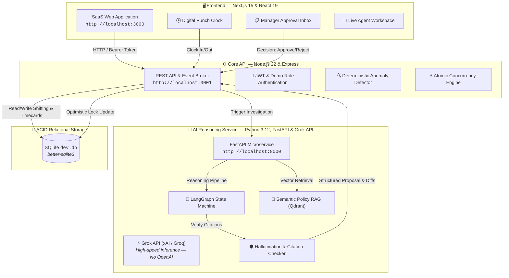
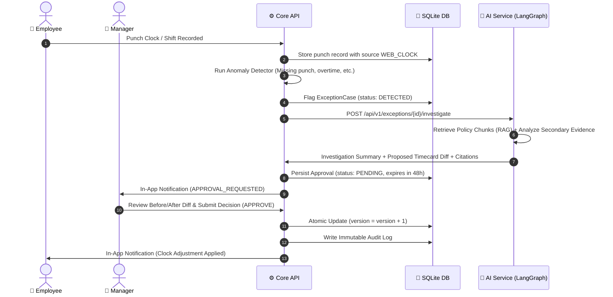

# AttendWise AI

<div align="center">


[](https://github.com/Anikesh994/DayForce/actions)
[-F55036?style=flat-square&logo=x&logoColor=white)](https://x.ai/)
[](https://nextjs.org/)
[](https://react.dev/)
[](https://nodejs.org/)
[](https://fastapi.tiangolo.com/)
[](https://python.org/)
[](https://sqlite.org/)
[](https://tailwindcss.com/)
[](LICENSE)

<br/>

**Agentic Time & Attendance Exception Management & Autonomous Resolution Platform**  
*DayForce AI Innovation Challenge — Technical Submission*

[Explore Architecture](#-system-architecture) •
[Agent Workflow](#-the-7-stage-agent-pipeline) •
[Quick Start](#-quick-start-guide) •
[Demo Personas](#-demo-personas--role-access) •
[Live Screens](#-key-application-screens--features)

</div>

---

## 🌟 Executive Overview

**AttendWise AI** is an enterprise workforce intelligence platform designed to eliminate the operational bottleneck of Time & Attendance (T&A) exception resolution. Traditional workforce systems detect punch anomalies—such as missing clock-outs, late arrivals, unscheduled overtime, and overlapping shifts—but leave investigation, policy reconciliation, and payroll modifications to tedious, manual, and error-prone human intervention.

AttendWise AI combines **deterministic anomaly detection**, **RAG-powered policy retrieval**, **multi-agent LangGraph reasoning**, and **Human-in-the-Loop (HITL) governance** to resolve attendance exceptions in seconds while guaranteeing policy compliance and 100% auditability.

```
┌────────────────────────────────────────────────────────────────────────┐
│                          ATTENDWISE AI VALUE LOOP                      │
│                                                                        │
│   [ 🕒 Punch / Badge Event ] ──────▶ [ 🔍 Rule-Based Detection ]       │
│                                                   │                    │
│   [ ⚡ Concurrency-Safe Update ] ◀── [ 👔 Manager Approval Inbox ]     │
│                 │                                 ▲                    │
│                 ▼                                 │                    │
│   [ 📜 Immutable Audit Trail ]       [ 🧠 Multi-Agent LangGraph RAG ]  │
└────────────────────────────────────────────────────────────────────────┘
```

---

## ✨ Key Platform Highlights

<table>
  <tr>
    <td width="50%">
      <h3>⏱️ Live Digital Web Clock</h3>
      <p>Interactive web punch clock allowing hourly workers to clock in, clock out, and inspect elapsed shift times with zero hardware requirements.</p>
    </td>
    <td width="50%">
      <h3>🧠 Multi-Agent Reasoning via Grok API</h3>
      <p>Specialized AI subagents powered by the <strong>Grok API</strong> (xAI / Groq high-speed inference, strictly without OpenAI) investigate anomalies, retrieve policy clauses via dense vector search, and formulate evidence-backed resolutions.</p>
    </td>
  </tr>
  <tr>
    <td width="50%">
      <h3>🛡️ Strict Human-in-the-Loop Approval</h3>
      <p>All consequential payroll and timecard adjustments require manager sign-off with clear side-by-side diffs and mandatory rejection justifications.</p>
    </td>
    <td width="50%">
      <h3>📚 RAG Policy Ingestion Hub</h3>
      <p>Upload corporate policy documents with automated semantic chunking, SHA-256 deduplication, and verified citations with snippet grounding.</p>
    </td>
  </tr>
  <tr>
    <td width="50%">
      <h3>🔔 Intelligent Notification Center</h3>
      <p>Contextual in-app notification hub with live unread badge counters and deep links directly into exceptions, approvals, and shifts.</p>
    </td>
    <td width="50%">
      <h3>🔒 Optimistic Concurrency & Auditability</h3>
      <p>ACID-compliant SQLite transaction safety with version-locked updates (<code>version = version + 1</code>) and an immutable audit log.</p>
    </td>
  </tr>
</table>

---

## 📐 System Architecture

The monorepo follows an enterprise decoupled microservice architecture:



---

## 🔄 The 7-Stage Agent Pipeline



| Stage | Name | Role & Responsibility |
|:---:|---|---|
| **1** | **Detection** | Deterministic evaluation of punches against schedules (grace periods, 8-hour overtime thresholds, missing punch windows). |
| **2** | **Context Gathering** | Correlates shift boundaries, employee metadata, and manager reporting lines. |
| **3** | **Policy Retrieval (RAG)** | Performs dense vector lookup across ingested organizational handbooks and rules. |
| **4** | **AI Investigation** | LangGraph agent cross-references secondary access logs and assigns a confidence score. |
| **5** | **Resolution Planning** | Synthesizes a structured timecard adjustment with risk level (`LOW`, `MEDIUM`, `HIGH`) and citations. |
| **6** | **Human Review & Approval** | Surfaces before/after diffs in the Manager Approval Inbox for explicit human sign-off. |
| **7** | **Transactional Execution** | Executes atomic timecard adjustments under optimistic locking and appends an immutable audit entry. |

---

## 🛠️ Technology Stack Compliance

| Layer | Selected Tech | Architecture & Implementation Details |
|---|---|---|
| **Frontend** | **Next.js 15 (App Router) + React 19** | TailwindCSS, Lucide icons, responsive toast system, dynamic digital clock, and before/after diff inspector |
| **Domain API** | **Node.js 22 + Express + TypeScript** | ACID domain API, optimistic concurrency, transactional execution, centralized error boundaries |
| **AI Backend & LLM** | **Python 3.12 + FastAPI + Grok API** | High-throughput asynchronous service powered by the **Grok API** (xAI / Groq) for rapid deterministic inference and citation verification without OpenAI dependency |
| **AI Orchestration** | **LangChain + LangGraph** | StateGraph with nodes for investigation, policy retrieval, resolution planning, and reviewer verification |
| **Storage** | **SQLite via `better-sqlite3`** | Authoritative ACID relational data source with raw SQL migrations (zero Prisma per challenge rules) |
| **Vector Store** | **Qdrant + SQLite Chunks** | Dense cosine vector retrieval with grounded offline policy fallback |
| **Testing** | **Vitest + Python Validation** | Comprehensive automated unit and integration suite covering date math, concurrency, and detection |
| **CI / CD** | **GitHub Actions** | Automated CI pipeline with linting, testing, and production builds (`.github/workflows/ci.yml`) |

---

## 🚀 Quick Start Guide

### Prerequisites
- **Node.js** ≥ 20.x (Node 22 recommended)
- **Python** 3.12
- **npm** (bundled with Node)
- **Git**

### 1. Clone & Install Dependencies
```bash
git clone https://github.com/Anikesh994/DayForce.git
cd DayForce
npm install
```

### 2. Set Up Python AI Service & Grok API
The platform runs on the **Grok API** (xAI / Groq) for rapid deterministic inference with zero OpenAI dependencies.

```bash
cd apps/ai-service
python -m venv .venv

# On Windows:
.venv\Scripts\pip install .

# On Linux / macOS:
source .venv/bin/activate && pip install .

cd ../..
```

Configure your environment variables in `.env` (or pass via environment):
```env
LLM_PROVIDER=groq
GROQ_API_KEY=your_grok_or_groq_api_key_here
```

### 3. Initialize Database & Seed Demo Data
```bash
npm run seed
```
*Creates `dev.db`, sets up 15 relational tables, seeds 1 tenant, 11 users, 9 employees, 2 weeks of shift schedules, 5 corporate policies, and pre-populates pending approvals.*

### 4. Start All Services

You can launch all 3 services concurrently using:
```bash
npm run dev
```

Or run each service individually in separate terminals:

```bash
# Terminal 1: Core API (Port 3001)
npm run dev:api

# Terminal 2: Python AI Service (Port 8000)
npm run dev:ai

# Terminal 3: Next.js 15 Web Frontend (Port 3000)
npm run dev:web
```

Open **[http://localhost:3000](http://localhost:3000)** in your browser to access AttendWise AI.

---

## 🔑 Demo Personas & Role Access

All seeded accounts share the default password: **`demo1234`**

| Persona | Role | Email | Scope & Permissions |
|---|---|---|---|
| **Sarah Chen** | `HR_ADMIN` | `hr.admin@acme.com` | Org-wide exception management, policy uploads, executive audit trail |
| **David Miller** | `MANAGER` | `mgr.ops@acme.com` | Operations manager (Alice, Bob, Dan); reviews and approves timecards |
| **Lisa Park** | `MANAGER` | `mgr.tech@acme.com` | Technology manager (Eva, Frank, Grace); manages engineering attendance |
| **Alice Johnson** | `EMPLOYEE` | `alice.johnson@acme.com` | Live punch clock, personal shift schedule, view own exception cases |
| **System Admin** | `SYSTEM_ADMIN` | `sysadmin@acme.com` | System health diagnostics, raw event streams, configuration |

> 💡 **Instant Role Switcher**: Click any of the persona pills on the **[Login Page](http://localhost:3000/login)** or use the top navigation profile dropdown to instantly switch roles without re-typing credentials.

---

## 🗺️ Key Application Screens & Features

| Route | View Name | Capabilities & Purpose |
|---|---|---|
| `/dashboard` | **Executive Dashboard** | Real-time workforce KPIs, anomaly severity breakdown, and 1-click Attendance Scan trigger |
| `/approvals` | **Approval Inbox** | HITL decision portal for managers with side-by-side proposed changes diffs, status filters, and approval/rejection actions |
| `/attendance` | **Attendance & Web Clock** | Live digital timecard widget for clocking in/out with elapsed timer, plus historical shift records |
| `/exceptions` | **Exception Center** | Searchable table of attendance anomalies with status filters and direct links to case files |
| `/exceptions/[id]` | **Exception Detail Case** | 4-step lifecycle stepper, confirmed facts, missing info, RAG policy citations, and on-demand investigation |
| `/agents` | **AI Agent Workspace** | Interactive 7-stage architecture simulator with real-time log outputs and input requirement checklists |
| `/policies` | **Policy Knowledge Base** | Vector-indexed corporate policy viewer with 1-click upload modal, chunk inspector, and industry templates |
| `/notifications` | **Notification Hub** | Alert center with unread badges, mark-all-read action, test alert generator, and deep navigation links |
| `/audit` | **Immutable Audit Trail** | Chronological tamper-evident audit ledger with actor chips (User, System, Workflow) and delta diffs |

---

## 🧪 Automated Testing Suite

Execute the complete automated test suite:
```bash
npm --workspace=@attendwise/core-api run test
```

### Verified Passing Tests (32 / 32 — 100% Pass Rate)
- **`harness.test.ts` (11 tests)**:
  - Structured contract verification against Zod & Pydantic schemas.
  - Whitelist enforcement: allows timecard adjustments (`clock_in_utc`, `clock_out_utc`).
  - Strict guardrails: blocks AI from touching prohibited fields (`salary`, `hourly_rate`, `role`).
  - Citation grounding: verifies that policy citations correspond to retrieved chunks, preventing hallucinations.
  - Human-in-the-Loop governance: enforces mandatory justification on rejections.
  - Fallback resilience: verifies local deterministic synthesis when external AI service is unreachable.
- **`datetime.test.ts` (13 tests)**:
  - Grace period boundary thresholds (≤ 10 mins vs > 10 mins).
  - Worked duration calculation with lunch break deductions.
  - Overnight shift math spanning midnight boundaries.
  - Shift conflict and overlapping assignment detection.
- **`db.test.ts` (5 tests)**:
  - SQLite foreign key cascade integrity across reporting lines.
  - Idempotent deduplication keys (`dedupe_key`).
  - Optimistic concurrency locking (`version` increment validation).
  - Atomic transaction rollback on query errors.
- **`detector.test.ts` (3 tests)**:
  - Deterministic anomaly detection across 14-day historical shifts.
  - Persistence of detected exception cases into SQLite.
  - Idempotent scanning without record duplication.

---

## 📄 License

This project is licensed under the MIT License — see the [LICENSE](LICENSE) file for details.
