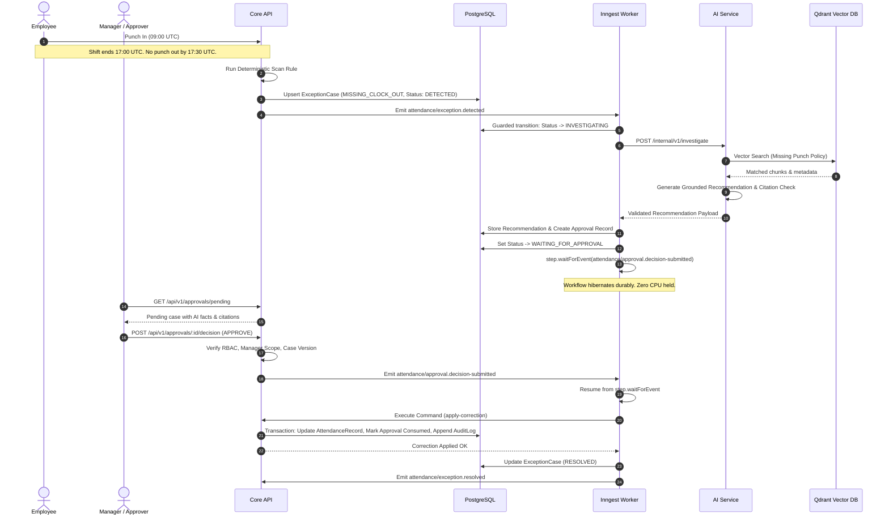

# AttendWise AI — System Architecture Specification

## 1. Executive Overview
**AttendWise AI** is an enterprise-grade agentic workforce management platform designed to detect, investigate, and resolve Time & Attendance (T&A) exceptions with high reliability, automated policy alignment, and mandatory human governance.

Unlike legacy rule systems that merely flag anomalies or unconstrained AI wrappers that hallucinate payroll modifications, AttendWise AI separates concerns across four distinct pillars:
1. **Deterministic Rule Engine (Core API):** Computes time intervals, grace periods, and schedule anomalies without probabilistic drift.
2. **AI Investigation & Policy RAG (AI Service):** Synthesizes contextual facts and extracts grounded citations from company policies via Qdrant vector retrieval.
3. **Durable Workflow Orchestrator (Inngest Worker):** Executes long-running business processes, manages step retries, backs off on transient errors, and suspends execution across multi-day human approval cycles.
4. **Human-in-the-Loop Governance (Core API & UI):** Ensures that consequential changes to official timecards are strictly authorized by authenticated managers/HR and applied through atomic, idempotent database transactions.

---

## 2. High-Level Architecture Diagram

```mermaid
flowchart TD
    subgraph ClientLayer ["Client Layer"]
        WebUI["Web Frontend (Next.js / React)"]
    end

    subgraph BusinessLayer ["Core Business Layer (Node.js / Express)"]
        CoreAPI["Core API Gateway"]
        AuthRBAC["RBAC & Scope Enforcer"]
        RuleEngine["Deterministic Exception Engine"]
        TxExecutor["Transactional Correction Executor"]
        AuditService["Immutable Audit Logger"]
    end

    subgraph DurableOrchestration ["Durable Orchestration Layer (Inngest Worker)"]
        InngestDev["Inngest Engine / Dev Server"]
        WorkflowWorker["Workflow Worker (Inngest Functions)"]
        WaitStep["step.waitForEvent (Human Decision)"]
    end

    subgraph AIServiceLayer ["AI Reasoning & Retrieval Layer (Python / FastAPI)"]
        AIService["AI Service Gateway"]
        InvestigatorAgent["Investigation Agent"]
        PolicyRAG["Policy Retrieval & Citations"]
        ResolutionPlanner["Resolution Planner Agent"]
        ReviewerAgent["Quality & Policy Reviewer"]
    end

    subgraph PersistenceLayer ["Persistence & Storage Layer"]
        Postgres[(PostgreSQL - Source of Truth)]
        QdrantDB[(Qdrant Vector DB)]
        LocalFS["File Storage / Storage Adapter"]
    end

    %% Interactions
    WebUI -->|HTTP / REST (JWT Auth)| CoreAPI
    CoreAPI --> AuthRBAC
    AuthRBAC --> RuleEngine
    RuleEngine --> Postgres
    CoreAPI -->|Publish Domain Events| InngestDev
    InngestDev -->|Trigger Durable Function| WorkflowWorker
    
    WorkflowWorker -->|Authenticated Internal Call| AIService
    AIService --> InvestigatorAgent
    InvestigatorAgent --> PolicyRAG
    PolicyRAG --> QdrantDB
    PolicyRAG --> ResolutionPlanner
    ResolutionPlanner --> ReviewerAgent
    
    WorkflowWorker -->|Pause Execution| WaitStep
    WebUI -->|Submit Approval Decision| CoreAPI
    CoreAPI -->|attendance/approval.decision-submitted| InngestDev
    InngestDev -->|Resume Workflow| WaitStep
    
    WaitStep -->|Invoke Command| TxExecutor
    TxExecutor -->|Atomic Transaction & Lock| Postgres
    TxExecutor --> AuditService
    AuditService --> Postgres
```

---

## 3. Component Boundaries & Responsibilities

### A. Web Frontend (`apps/web`)
- **Technology:** Next.js 15 / React 19, TypeScript, TailwindCSS, Lucide Icons.
- **Responsibilities:**
  - Executive dashboard with workforce KPI metrics.
  - Interactive attendance timeline and shift viewer.
  - Exception Center with faceted status/severity filters.
  - Case Detail view with AI investigation summary, confirmed facts, missing facts, and exact policy citations.
  - Manager Approval Inbox with side-by-side diffs (Original vs Proposed).
  - Policy document ingestion management.
  - Audit log and workflow execution traces.

### B. Core API / Business Service (`apps/core-api`)
- **Technology:** Node.js, Express, TypeScript, Prisma ORM.
- **Responsibilities:**
  - Authentication (JWT / Demo role switcher) and multi-tenant RBAC enforcement.
  - Source of truth for employees, shifts, punches, exceptions, approvals, and audit records.
  - Deterministic exception detection engine (boundary and timezone-aware calculations).
  - Atomic database transactions with optimistic locking (`version` column).
  - Event dispatch to Inngest (`inngest.send()`).
  - Strict rejection of unauthorized direct mutations.

### C. Workflow Worker (`apps/workflow-worker`)
- **Technology:** Node.js, TypeScript, Inngest SDK.
- **Responsibilities:**
  - Durable workflow orchestration for multi-step exception lifecycles.
  - Automated step-level retries with exponential backoff on transient errors (network, LLM rate limits).
  - Durable human-in-the-loop pauses using `step.waitForEvent`.
  - Non-retriable error routing for schema/business validation failures.
  - Deadlines, reminders, and auto-escalations using `step.sleep`.

### D. AI Service (`apps/ai-service`)
- **Technology:** Python 3.12, FastAPI, Pydantic v2, Qdrant Client.
- **Responsibilities:**
  - LLM-assisted anomaly investigation.
  - Query transformation and semantic vector retrieval over policy handbooks.
  - Citation validation: ensuring every cited clause exists in retrieved chunks.
  - Structured recommendation generation (proposed punch times, rationale, required approver).
  - AI Reviewer check to prevent hallucinated changes or policy violations.
  - Strictly read-only: **zero** direct write access to business databases.

---

## 4. End-to-End Exception Lifecycle



---

## 5. Security & Isolation Invariants
1. **AI Output Is Untrusted Input:** Every field generated by LLMs is strictly validated through Pydantic / Zod schemas before being passed to business layers.
2. **Least Privilege Mutability:** Only the Core API's transactional executor can mutate official attendance records.
3. **Optimistic Concurrency:** If an attendance record is modified concurrently while an approval is pending, the version check fails (`STALE_RECORD_CONFLICT`), forcing re-investigation.
4. **Audit Immutability:** Audit log records are append-only and record the actor, action, previous state, new state, and correlation ID.
